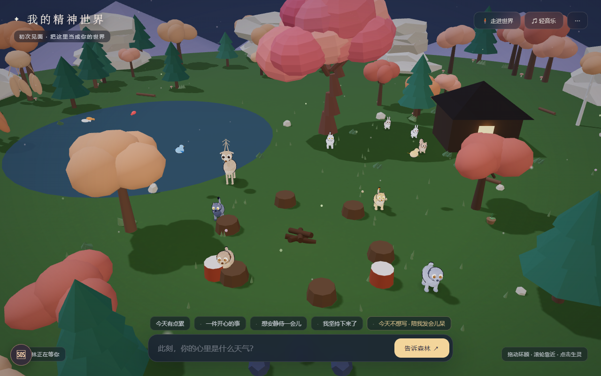
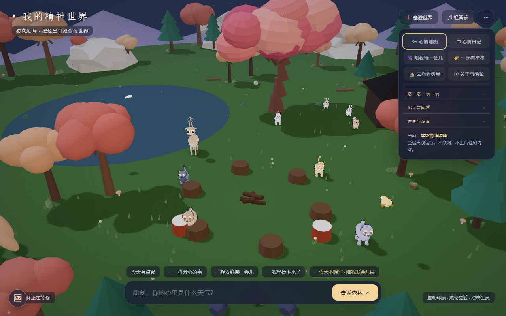
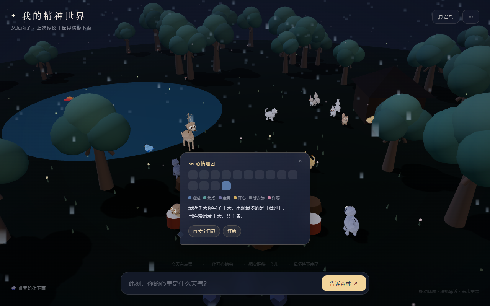
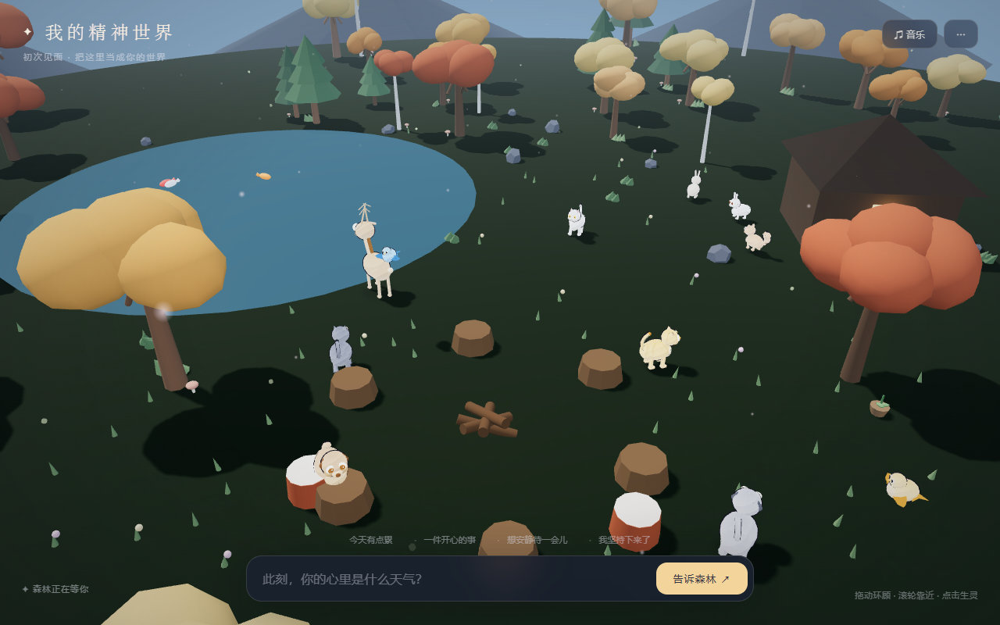

# 精神世界 · Mindscape

一个**单文件、离线、可触摸的 3D 情绪陪伴世界**。

写下今天的心情，森林会换天气、亮起对应的光，动物会走过来陪你；你的心情会被记住，慢慢攒成地图、曲线和一封信。

> 当前版本：单文件 `index.html`（约 1.0 MB，three.js 已内联，无构建步骤、无外部依赖），双击即用。
> 推荐浏览器：Chrome / Edge（桌面），手机可用。

---

## 它是什么

不是心理治疗工具，也不是聊天机器人。它是一个「可以待一会儿」的地方：

- 你说一句心情 → 世界的天气与光变化 → 对应的动物过来陪你
- 你说过的话会被记住：当天「刚才你说…」，隔天「上次你说…，我记着呢」
- 你可以在里面喂动物、建树屋、看星星、布置小屋，甚至走进森林里散步
- 所有数据只存在你自己的浏览器里，不联网、不上传

---

## 功能

### 🌙 情绪与陪伴
- 七种基础情绪 + 「想独处」「说不清」「危机」分支
- 否定句、强度词、混合情绪、话题识别（工作/学习/家人/感情/身体）
- 危机兜底：温柔接住 + 心理援助热线 12356 + 「陪我待一会儿」
- 深呼吸、专注、把情绪放出去等小练习；🆘 帮助按钮

### 🧠 记忆与回顾
- 心情日记、连续天数、首屏真实问候
- 心情地图（最近 30 天色块，可点某天，可导出心情色卡）
- 情绪的起落、我的天气相册、我这一年、那年的今天、时间胶囊
- 每天的自动备份（保留 7 天），可导出 / 导入 / 恢复

### 🐾 生灵
- 11 只低多边形动物（3 猫 2 狗 2 鸟 1 松鼠 2 兔 1 鹿）+ 湖里锦鲤
- 眨眼、四腿走路、坐下/打滚/张望；喂食增加亲密度；生灵图鉴可召唤
- 动物之间自动保持距离，不会走进湖里

### 🌳 世界
- 按季节变化的五种树木（阔叶/松/白桦/垂柳/春樱）、地面植被、远山；树冠随风摆动
- 五个时间段（跟随现实/夜/黄昏/清晨/白天），1.6 秒渐变；环境音分层（风/水/鸟/虫）
- 烟花、花瓣、看星星许愿、篝火音乐会
- 树屋：三次选择建造 + 秋千/二层/灯串扩建，竣工后镜头自动转过去
- 第一人称「走进世界」：WASD/摇杆、跑、跳、进屋、上树屋；小屋可亲手布置

### 🖼 分享与无障碍
- 心情色卡、明信片、年度信可导出图片
- 大字护眼、键盘可达、可减少动效

### 🔒 隐私
- 全程离线：页面不发起任何网络请求
- 数据只存本机 `localStorage`；清浏览器数据会丢失，建议定期「导出记忆」
- 仓库里不含任何个人数据（日记只在你本机）

---

## 快速开始

**方式一：直接打开**
1. 下载 `index.html`
2. 用 Chrome / Edge 双击打开

**方式二：GitHub Pages（可选）**
在仓库 Settings → Pages 里选择 `main` 分支根目录，访问生成的网址即可。

**操作**
| 场景 | 操作 |
|------|------|
| 看世界 | 鼠标拖动环顾、滚轮缩放；手机单指拖动、双指缩放 |
| 互动 | 点动物、点篝火、点右上「⋯」 |
| 走进世界 | WASD / 方向键走动，Shift 跑，空格跳，E 进屋/上树屋，Esc 退出 |
| 写心情 | 底部输入框回车，或点快捷胶囊 |

---

## 目录结构

```
my-mindscape/
├─ index.html                 # 全部应用（HTML + CSS + JS + 内联 three.js）
├─ README.md
├─ CHANGELOG.md               # 各轮更新摘要
├─ docs/
│  ├─ 使用说明.md              # 更完整的功能说明
│  └─ 修改记录-第十轮.md       # 当前版本这一轮的修改与验证
├─ screenshots/
│  ├─ default.png
│  ├─ menu.png
│  ├─ mood-map.png
│  └─ forest.png
├─ .gitignore
└─ .nojekyll                  # GitHub Pages 用
```

---

## 技术说明

- **原生 HTML/CSS/JS**，无框架、无构建、无 npm 依赖
- **three.js r159** 内联在 `index.html` 中（约 660 KB 压缩代码），保证单文件离线
- 所有模型与贴图由代码生成（低多边形 + Canvas 贴图），不加载外部资源
- 声音用 **Web Audio** 实时合成（篝火旋律、雨声、风/水/鸟/虫）
- 持久化用 **localStorage**，含自动备份环
- 桌面与移动端共用一套交互，移动端有虚拟摇杆与画质档位

### 想改代码
- 应用代码在 `index.html` 末尾的 `<script>` 里；third-party three.js 在中间单独一段（注意别改坏）
- 关键入口：`makePet`（动物）、`makeTree`（树）、`applyMood`（情绪回应）、`Memory`（存储）、`animate`（主循环）
- 改完直接刷新浏览器即可，不需要编译
- 建议保留「单文件离线」特性；若要拆分，请同步调整内联库

---

## 截图









---

## 更新记录

见 [CHANGELOG.md](CHANGELOG.md)。

---

## 免责声明

这是一个**陪伴向的自我表达工具**，不是专业心理咨询或医疗服务。如果你或身边的人正处于危险中，请立即联系当地急救（120/110）或全国心理援助热线 **12356**。

---

## 许可

仓库暂未附加开源许可证；如需 MIT / CC BY-NC 等，可自行补充。
